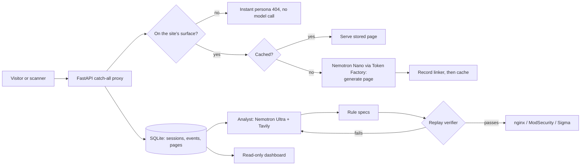

# Mirage: a honeypot that improvises

  

> An LLM-driven web honeypot that answers *whatever* an attacker asks, in the consistent style of one fictional company, plus an analyst agent that turns the captured attacks into detection rules it has **verified against logged traffic before proposing them**.

**Nebius x NVIDIA Global AI Hackathon 2026 · Track: Best Apps and Agents**

| | |
|---|---|
| Demo (static export of real output) | (https://about-mirage.netlify.app/) |
| Demo video (under 3 minutes) | REPLACE_WITH_YOUTUBE_URL |
| Models | NVIDIA **Nemotron 3 Nano 30B-A3B** (live responses) and **Nemotron 3 Ultra 550B-A55B** (analysis), served by **Nebius Token Factory** |
| Web search | **Tavily** (CVE leads for the analyst) |

---

## The problem

A honeypot is only useful if attackers believe in it. The common design clones a site: it serves the pages it copied, returns a 404 for everything else, and its login form leads nowhere. Scanners notice, move on, and the defender learns little. Even when a honeypot does record an attack, someone still has to read the logs and write the defenses.

## What Mirage does

1. **Deceives.** A *persona* (a fictional company with a stack, staff, database schema, menu, record URL patterns and tempting "lure" pages) is designed once by Nemotron Ultra. Every later response is generated in that persona's style, cached, and served identically on a repeat visit, so the site stays consistent.
2. **Improvises where a clone cannot.** Unbounded content, such as the page for shipment `PRO-48213`, a failed login, or a section index, is generated on request by Nemotron Nano. Paths that do not belong to the site get the persona's own instant 404, with no model call.
3. **Analyses.** An offline analyst agent classifies each recorded session (intent, MITRE ATT&CK technique, severity), enriches it with Tavily web search for CVE leads, and proposes detection rules.
4. **Verifies before it proposes.** Each proposed rule is replayed against every logged request and a benign baseline. A rule that blocks legitimate traffic goes back to the model with the exact requests it got wrong, and is rejected if it cannot be fixed. Verified rules are rendered as **nginx**, **ModSecurity** and **Sigma** by deterministic templates, never by the model.

## Architecture



Guards around the model: a per-session call budget, a global concurrency limit, hard timeouts with a persona-styled fallback page, retries with backoff, single-flight coalescing of simultaneous requests for one URL, attacker text fenced and escaped inside prompts, and request bodies capped while streaming. A page that must exist (a known page, a lure, or a record page) is never cached as a 403 or 404: it is regenerated once, and if that fails it is not cached.

## How Mirage uses NVIDIA Nemotron and Nebius

| Tier | Model (Token Factory ID) | Used for |
|---|---|---|
| fast | `nvidia/NVIDIA-Nemotron-3-Nano-30B-A3B` | Live page and JSON generation on every cache miss, and pre-building the site's pages |
| smart | `nvidia/Nemotron-3-Ultra-550b-a55b` | Persona, menu and lure design; session classification (intent, ATT&CK, severity, search queries); proposing and revising detection rules |

**Where Token Factory helped.** Its OpenAI-compatible API meant moving from NVIDIA's free hosted endpoint to Token Factory was three environment variables (base URL, key, model IDs) and no code change. In the final evaluation, 59 live page generations on Nano had a **median of 3.8 s (p90 4.6 s)** and **no failures**; on the free hosted endpoint, 8 of 63 requests had failed with capacity errors. The smart-tier persona design took about 3 s on Token Factory against 19 to 31 s before. The tier split is what keeps the live path responsive while the heavy reasoning happens offline.

**Other services.** Tavily (runtime web search). No other Nebius services were used: no Serverless Endpoints or Jobs, and no AI Cloud compute.

Early development used NVIDIA's free hosted endpoint. All results below come from Nebius Token Factory.

## Results

Four scripted attacker profiles (a recon bot, a vulnerability scanner, a login brute-forcer and a link-following crawler) were run against two copies of the same site: a **static baseline** (the same pre-built pages, but nothing generated on demand, anything else is a 404) and **Mirage**. Both start from identical pages, menu and lures. Each profile stops after 40 requests.

| | Static baseline | Mirage |
|---|---|---|
| Distinct pages that returned content, **per run** | 18 | **48** (2.7x) |
| Attack payloads answered (not 404), three runs combined | 0 of 30 | **24 of 30** (8 of 10 per run) |
| Login attempts answered (not 404), three runs combined | 0% | **100%** |
| Responses that were dead-end 404s, three runs combined | 79% | **25%** |

Model cost and speed in the Mirage runs: 59 live generations, 89,528 prompt and 26,764 completion tokens in total, no failures across 267 requests per mode.

Read these numbers with care:

- The attackers are **scripted**. They react only to what responses contain; they are not real adversaries.
- The three runs replay the same scripted traffic against the same cache, so they confirm repeatability. They are **not independent samples**. Report the per-run figures, not the sums.
- The crawler reached its 40-request cap in both modes, so the page counts are **lower bounds**.
- The static baseline is a simplified stand-in for clone-only honeypots, not a specific product. Its pages carry the same record links, which lead to 404s because a clone cannot hold unbounded records. That gap is exactly what is being measured.
- One fictional company, one configuration. The full report is in [`results/`](results/).

## From sessions to verified rules

On the 12 recorded attacker sessions the analyst produced 12 findings and **4 verified rules (1 rejected)**, checked against 319 replayed requests with **0 false positives**. Tavily returned 36 distinct CVE mentions, 26 of them for the Apache version the honeypot advertises. These are leads to investigate, not confirmed vulnerabilities.

Example, rendered from one verified rule (`Admin panel enumeration`, 48 attack requests caught, 0 false positives):

```nginx
set $mr_1536110 "";
if ($request_method = GET) { set $mr_1536110 "${mr_1536110}M"; }
if ($uri ~* "^/(admin|administrator|wp-login\\.php|phpmyadmin|console|server-status|cgi-bin|info\\.php|test)/?$") { set $mr_1536110 "${mr_1536110}P"; }
if ($mr_1536110 = "MP") { return 403; }
```

The rejected rule is the interesting one: "Rapid sequential ID enumeration" caught 78 attack requests but also blocked one legitimate request, was sent back for revision three times, and was refused. A per-request rule cannot express "too many, too fast", and the verifier said so instead of shipping a bad rule.

**Validation.** The nginx output is syntax-checked and behaviour-tested against a real nginx in the test suite when nginx is installed. The ModSecurity output was syntax-checked and behaviour-compared against Apache with `mod_security2` during development. The Sigma output is parsed as YAML in the tests.

**What the verification does not show.** Recall is measured on the same lab traffic the rules were written from, with no held-out attack set. The benign baseline is synthetic. Two rules match exact filenames and are narrow by design. Treat the output as proposals for a human to review.

## Dashboard

`scripts/dashboard.py` serves a read-only dashboard on `127.0.0.1:8081`: how requests were answered (cache, generated, instant 404), every session with a request-by-request timeline, the analyst's findings with ATT&CK techniques and CVE leads, each verified rule with its replay numbers and all three formats, and the static-versus-Mirage report. Everything shown came from attackers, so all of it is HTML-escaped, the pages contain no JavaScript, and a strict Content-Security-Policy blocks scripts even if escaping failed. The tests feed it `<script>` payloads.

## Quickstart

Requires Python 3.11 or newer and a Nebius Token Factory API key ([tokenfactory.nebius.com](https://tokenfactory.nebius.com)). A Tavily key is optional.

```bash
git clone https://github.com/REPLACE_WITH_YOUR_USERNAME/mirage-honeypot.git
cd mirage-honeypot
python -m venv .venv && . .venv/bin/activate
pip install -r requirements-dev.txt

cp .env.example .env                # add NEBIUS_API_KEY (and optionally TAVILY_API_KEY)
set -a && . ./.env && set +a        # load it (repeat in every new terminal)

python -m pytest -q                 # 49 tests, no API key needed (nginx tests skip if nginx is absent)
python scripts/list_models.py nemotron   # confirm model IDs for your account; edit MODEL_FAST / MODEL_SMART if they differ
python scripts/check_llm.py              # latency check and persona sanity check
python scripts/enrich_persona.py         # designs the fictional company and builds its pages (about 2 minutes)

HOST=127.0.0.1 python -m mirage          # the honeypot on http://127.0.0.1:8080
```

Open `http://127.0.0.1:8080`, click through the shipment tables, and try `/.env` or an unknown path under `/shipments/`. Then, in another terminal (same environment):

```bash
# generate attacker traffic against YOUR OWN instance only
python scripts/simulate_scan.py http://127.0.0.1:8080 --profile all

# the static-vs-Mirage comparison (own servers on ports 8091/8092; replaces ab_work/)
python scripts/ab_run.py --runs 3

# analyse the recorded sessions, then look at them
cp ab_work/mirage.db evidence.db
python scripts/analyze.py --db evidence.db
python scripts/dashboard.py --db evidence.db --mask-ips      # http://127.0.0.1:8081

# optional: export the dashboard and company site as a static, JavaScript-free demo
python scripts/export_demo.py --db evidence.db --ab ab_results.json
```

Notes: `enrich_persona.py` deletes and rebuilds the pre-built pages; add `--keep-pages` to build only missing ones. `scripts/preview_page.py /path` generates one page without touching the cache, which is the fast way to check a prompt change. Without an API key the honeypot still runs, serving a built-in persona with fallback pages.

## Configuration

| Variable | Default | Meaning |
|---|---|---|
| `NEBIUS_API_KEY` | none | Token Factory key (the code reads this name for any OpenAI-compatible endpoint) |
| `NEBIUS_BASE_URL` | `https://api.tokenfactory.nebius.com/v1/` | API endpoint |
| `MODEL_FAST`, `MODEL_SMART` | see `.env.example` | Live-generation and analysis models |
| `LLM_EXTRA_BODY` | empty | Extra JSON merged into every request (for example a model's reasoning-off switch) |
| `LLM_TIMEOUT_S`, `LLM_SMART_TIMEOUT_S` | 30, 90 | Per-call time limits |
| `LLM_MAX_RETRIES`, `LLM_MAX_CONCURRENCY` | 3, 8 | Retry and concurrency limits |
| `MAX_LLM_CALLS_PER_SESSION` | 60 | Cost cap per visitor session |
| `MIRAGE_MODE` | `mirage` | `static` serves only pre-built pages (the baseline) |
| `DB_PATH`, `HOST`, `PORT` | `mirage.db`, `0.0.0.0`, `8080` | Storage and listener |
| `TAVILY_API_KEY` | none | Enables CVE enrichment in the analyst |

## Repository layout

```
mirage/
  honeypot.py   FastAPI catch-all app          engine.py    cache, surface routing, generation, logging
  persona.py    persona design, surface sets   linking.py   deterministic record linking
  llm.py        Token Factory client, tiers    prompts.py   all prompts (attacker text is fenced)
  db.py         SQLite schema (events, sessions, findings, rules)
  analyst.py    classification, enrichment, rule verify-and-revise loop
  rules.py      rule specs, matcher, nginx/ModSecurity/Sigma renderers
  enrich.py     Tavily client       benign.py   benign baseline       compare.py   comparison statistics
  dashboard.py  read-only dashboard  demo_export.py   static demo export
scripts/        list_models, check_llm, enrich_persona, preview_page, simulate_scan, ab_run, analyze,
                stats, dashboard, export_demo, relink_pages, warm_cache, add_lures
tests/          49 tests (fake model, no network)    results/   final comparison and analysis output
```

## Safety and ethics

- Run it on an isolated host with no real data or credentials, and only test against infrastructure you own. `HOST=127.0.0.1` keeps it local.
- The honeypot never executes anything from a request. Every generated page is fictional, and a model's "secrets" are made up.
- Source IPs are personal data in many places: keep retention short and mask them in public material (the dashboard has `--mask-ips`, and the static export always masks).
- Rules are proposals. Review them against your own traffic before deploying.

## Limitations

- Scripted attackers and lab traffic only: no real internet traffic yet, and no test against honeypot-fingerprinting tools.
- Generated pages take seconds, where a real server answers in milliseconds. Caching and pre-building hide most of it, but latency is a possible tell.
- Rules are per request. Rate-based behaviour such as brute-forcing cannot be expressed.
- One persona, one stack, and a synthetic benign baseline.

## Development notes

Mirage was written during the hackathon Submission Period, from October 2026. It relates to the author's MSc research topic (web-application honeypots) but reuses none of that work's data. It was developed with substantial assistance from an AI coding assistant (Claude, by Anthropic); the author directed the design, ran every experiment, and the numbers in this README come from those runs.

## Acknowledgements

Nebius Token Factory and NVIDIA Nemotron for the models, Tavily for search, and the open-source projects FastAPI, uvicorn, the OpenAI Python SDK, httpx, pytest and PyYAML.

## License

[MIT](LICENSE)
